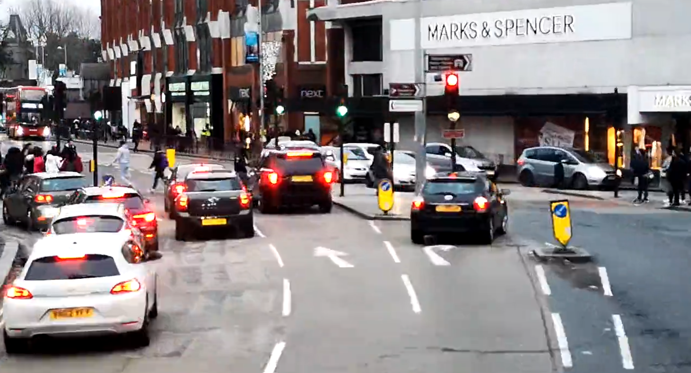
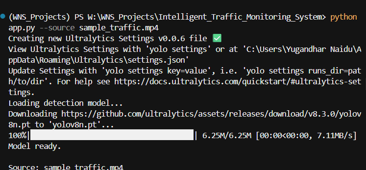
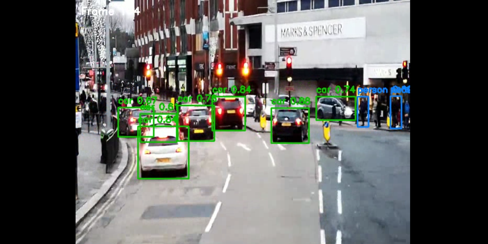
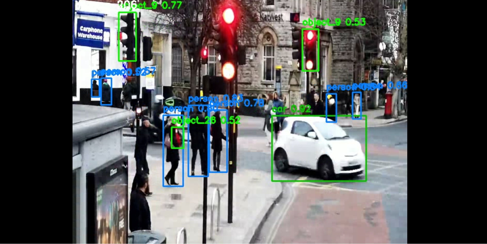
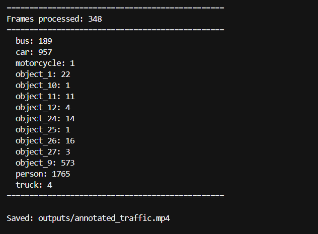

# Intelligent Traffic Monitoring System

Computer vision pipeline for CCTV or dashcam footage: detects pedestrians, cars, buses, trucks, and motorcycles using YOLOv8. Annotated video and per-class detection counts support traffic flow review and basic monitoring workflows.

## Project background

Traffic teams often review recorded clips manually. This project automates object detection on each frame, draws labeled bounding boxes, saves an output video, and prints a summary count by class (useful for rough flow analysis). It is built for offline video files or a live webcam feed.

## Features

- Real-time-style processing on video files or webcam (`--source 0`)
- YOLOv8 nano model (`yolov8n.pt`) — downloads on first run if missing
- Classes: person, car, motorcycle, bus, truck
- Colour-coded boxes per class
- Annotated MP4 output under `outputs/`
- Optional matplotlib preview of sampled frames
- Adjustable confidence threshold

## Requirements

- Python 3.8+
- Windows/macOS/Linux with OpenCV support
- GPU optional (CPU inference works; slower on long clips)

```powershell
cd Intelligent_Traffic_Monitoring_System
python -m venv .venv
.\.venv\Scripts\activate
pip install -r requirements.txt
```

**Note:** Place your test video in the project folder (e.g. `sample_traffic.mp4`) or pass any path with `--source`. Large videos and `yolov8n.pt` are gitignored; the model is fetched automatically when Ultralytics runs.

## How to run

**Video file (default expects `sample_traffic.mp4` in this folder):**

```powershell
python app.py --source sample_traffic.mp4
```

**Custom paths and no GUI preview (good for long runs):**

```powershell
python app.py --source path\to\your_video.mp4 --output outputs\my_run.mp4 --no-preview
```

**Webcam:**

```powershell
python app.py --source 0 --output outputs\webcam_session.mp4
```

**Stricter detections:**

```powershell
python app.py --source sample_traffic.mp4 --conf 0.65
```

After a successful run, open `outputs/annotated_traffic.mp4` in a media player and check the terminal for the detection summary table.

## How it works

1. `detector_core.py` — loads YOLOv8, labels traffic-related COCO classes, runs inference per frame.
2. `app.py` — reads frames, resizes to 640×480, annotates, writes MP4, aggregates counts, optional preview.

## Application screenshots

### Input sample



Raw clip used for testing (busy road or avenue footage).

### Model / startup



Environment setup or first-time YOLO weights download.

### Detection output



Cars and other vehicles with confidence labels.



Mixed pedestrians and vehicles in the same scene.

### Run summary



Per-class detection totals after the full video is processed.

## Performance notes

- Default confidence: 0.5 (`--conf` to change)
- Frame size fixed at 640×480 for speed
- Preview shows every 5th processed frame when preview is enabled

## Repository layout

```
Intelligent_Traffic_Monitoring_System/
  app.py
  detector_core.py
  requirements.txt
  README.md
  assets/
  outputs/         # local only (gitignored)
```
