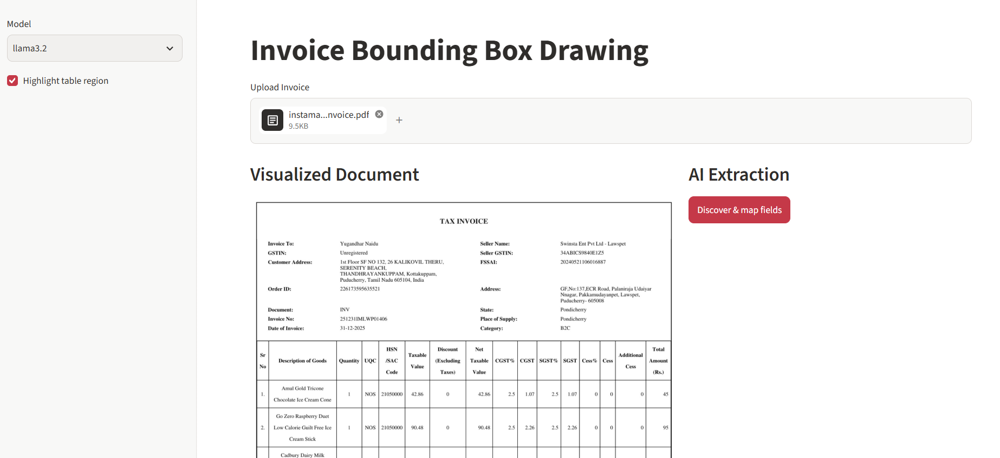
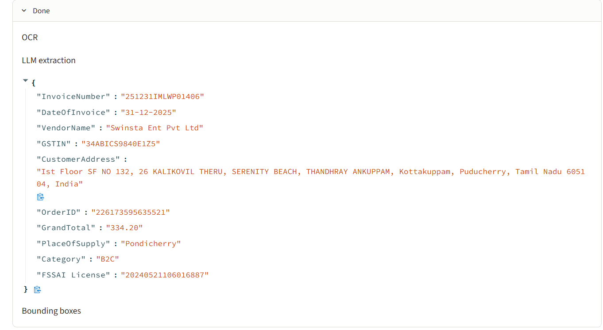
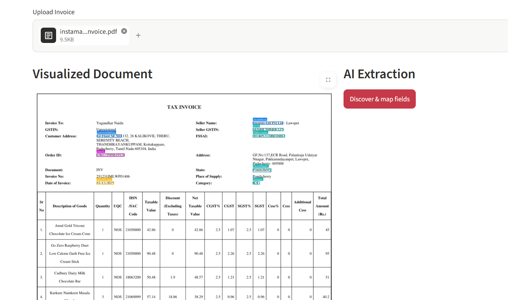

# Invoice Bounding Box Drawing

An invoice visualization app that uses OCR and a local LLM to find key fields, then draws colour-coded bounding boxes on the document with OpenCV. Field discovery is dynamic (no fixed invoice template).

## Features

- **Dynamic field discovery** — Ollama picks important header, tax, and amount fields
- **OCR + fuzzy match** — Tesseract word positions mapped back to extracted values
- **Bounding boxes** — OpenCV overlays per field; optional table-grid highlight
- **Formats** — PDF, PNG, JPG, DOCX (first page)
- **Streamlit UI** — Document preview and JSON side by side

## Requirements

- Python 3.10+
- Tesseract OCR ([Windows installer](https://github.com/UB-Mannheim/tesseract/wiki))
- Ollama with a pulled model (`ollama pull llama3.2`)
- ~2 GB free RAM

Set Tesseract when it is not on PATH:

```powershell
$env:TESSERACT_PATH = "C:\Program Files\Tesseract-OCR\tesseract.exe"
```

## How to run

```powershell
cd W:\WNS_Projects\Invoice_Bounding_Box_Drawing
python -m venv .venv
.\.venv\Scripts\activate
pip install -r requirements.txt
streamlit run app.py
```

Open http://localhost:8501, upload an invoice, click **Discover & map fields**.

## How it works

1. Load PDF/image/DOCX → first page as image  
2. Tesseract OCR → full text + word coordinates  
3. Ollama → flat JSON of fields; `invoice_pipeline.py` refines totals and IDs  
4. Fuzzy match → locate each value on the page  
5. OpenCV → draw colour-coded boxes and optional table outline  

## Application screenshots

### Input invoice



Swiggy Instamart tax invoice (PDF) used as test input.

### Extracted JSON



Ollama extraction with post-processing (invoice number, GSTIN, grand total, FSSAI, etc.).

### Bounding box visualization



OpenCV draws boxes where OCR tokens match extracted values; JSON may list more fields than boxed regions.

## Notes

- Processing runs locally (Tesseract + Ollama).
- Bounding boxes appear only when extracted values align with OCR word positions on the page.
- Accuracy depends on scan quality and layout.
