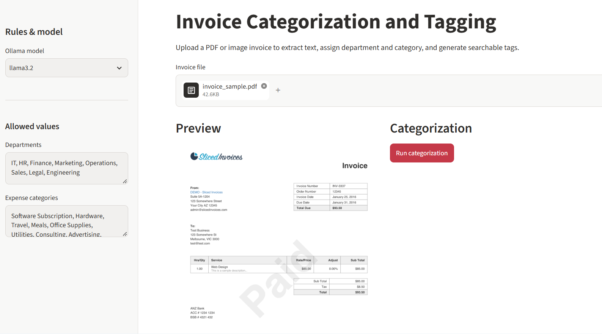
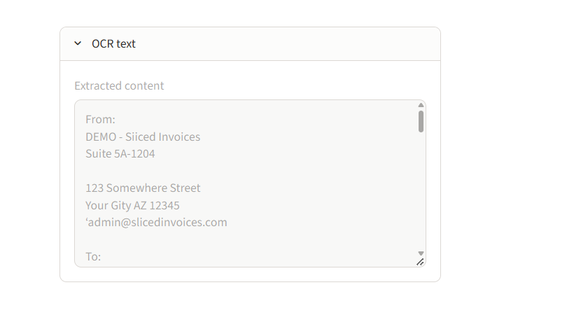
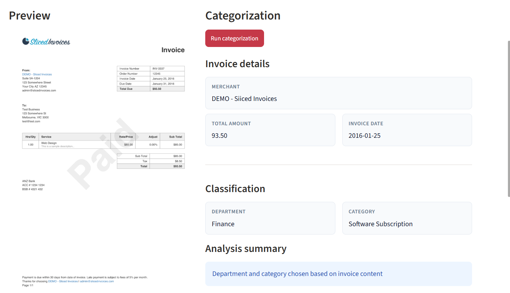
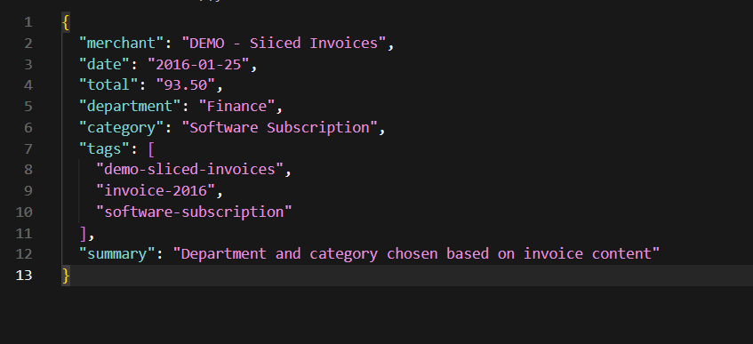

# Invoice Categorization and Tagging

System to categorize and tag invoices from PDF or image uploads. Text is extracted with OCR, then a local Ollama model assigns department, expense category, metadata tags, and a short summary within lists you define in the sidebar.

## Features

- PDF and image upload (PNG, JPG, JPEG)
- Tesseract OCR with basic image preprocessing
- Department and category rules you configure in the UI
- Tag generation for search and reporting
- JSON download for downstream accounting or reporting tools
- Local processing via Ollama (no cloud API required for classification)

## How It Works

1. Upload an invoice (PDF or image).
2. OCR runs on each page (PDF) or the image file.
3. Optional: review extracted text in the **OCR text** expander.
4. Click **Run categorization** to call Ollama with your allowed departments and categories.
5. Review merchant, total, department, category, tags, and download JSON if needed.

### Output JSON shape

```json
{
  "merchant": "Vendor Name",
  "date": "YYYY-MM-DD",
  "total": "Amount",
  "department": "IT",
  "category": "Software Subscription",
  "tags": ["software", "monthly", "it"],
  "summary": "Short justification line"
}
```

## Prerequisites

- Python 3.10+
- [Tesseract OCR](https://github.com/tesseract-ocr/tesseract) installed on the machine
- [Ollama](https://ollama.com/) installed with at least one model pulled (e.g. `llama3.2`)

### Tesseract on Windows

Install Tesseract, then set the path before starting the app (adjust if your install path differs):

```powershell
$env:TESSERACT_PATH = ""
```

## How to Run

From the project folder:

```powershell
cd WNS_Projects\Invoice_Categorization_and_Tagging
python -m venv .venv
.\.venv\Scripts\Activate.ps1
pip install -r requirements.txt
ollama pull llama3.2
streamlit run app.py
```

Ensure the Ollama service is running (typically starts with the Ollama app or `ollama serve`).

## User Interface





## Sample Output





## Sidebar Configuration

- **Ollama model**: `llama3.2`, `mistral`, or `llama3`
- **Departments**: comma-separated allowed values
- **Expense categories**: comma-separated allowed values (classification is constrained to this list)

## Notes

- Processing runs on your machine; invoice files are not sent to external SaaS by this app.
- OCR accuracy depends on scan quality and Tesseract language packs (default English).
- If classification fails, confirm Ollama is running and the selected model is pulled.

## Project Background

Finance and operations teams often receive invoices in mixed formats (email PDFs, photos, scans). Manual sorting by department, expense type, and project slows month-end close. This app automates first-pass tagging: OCR pulls text, then a local LLM maps content to your predefined departments and categories and emits tags plus JSON for reconciliation or dashboards.
