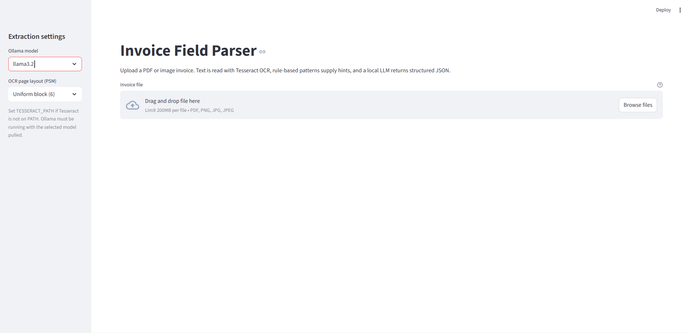
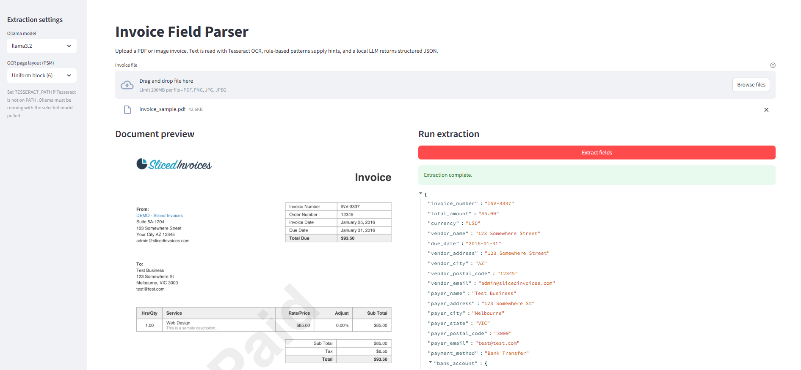

# Invoice Data Extraction

Streamlit application that extracts structured invoice fields from PDF or image uploads using Tesseract OCR, regular-expression hints, and a local Ollama model via LangChain.

## Features

- **PDF and images** — PNG, JPG, JPEG, and multi-page PDF input
- **OCR** — Tesseract with selectable page-segmentation modes
- **Rule-based hints** — pattern matching for invoice number, date, totals, currency, and vendor name
- **LLM structuring** — `llama3.2`, `llama3`, or `mistral` with JSON output and empty-field stripping
- **Review aids** — OCR text expander, hints expander, and JSON download

## Project Background

Skense delivery training includes computer vision, NLP, and GenAI module development. This project combines document OCR with LangChain prompt templates so trainees can see an end-to-end pipeline from scanned invoices to JSON suitable for downstream APIs or spreadsheets. Rule-based parsing narrows the search space before the model formats the final payload.

## Prerequisites

- Python 3.10 or later
- [Tesseract OCR](https://github.com/tesseract-ocr/tesseract) installed on the system PATH, or `TESSERACT_PATH` set to `tesseract.exe` (Windows example: `C:\Program Files\Tesseract-OCR\tesseract.exe`)
- [Ollama](https://ollama.com) running locally with at least one model:

```powershell
ollama pull llama3.2
```

Optional models:

```powershell
ollama pull llama3
ollama pull mistral
```

## How to Run

From the repository root:

```powershell
cd WNS_Projects\Invoice_Data_Extraction
python -m venv .venv
.\.venv\Scripts\Activate.ps1
pip install -r requirements.txt
$env:TESSERACT_PATH = "C:\Program Files\Tesseract-OCR\tesseract.exe"
streamlit run app.py
```

Open the URL shown in the terminal (typically `http://localhost:8501`).

## User Interface



The sidebar selects the Ollama model and OCR PSM mode. After upload, the first page preview appears on the left; use **Extract fields** on the right.

## Sample Output



A successful run shows normalized JSON, a **Download JSON** button, and expanders for raw OCR text and rule-based hints.

Example extraction from a USD sample invoice (invoice number, total, currency, vendor and payer details, payment method, and terms when present on the document):

```json
{
  "invoice_number": "INV-3337",
  "total_amount": "85.00",
  "currency": "USD",
  "vendor_name": "123 Somewhere Street",
  "due_date": "2016-01-31",
  "vendor_address": "123 Somewhere Street",
  "vendor_city": "AZ",
  "vendor_postal_code": "12345",
  "vendor_email": "admin@slicedinvoices.com",
  "payer_name": "Test Business",
  "payer_address": "123 Somewhere St",
  "payer_city": "Melbourne",
  "payer_state": "VIC",
  "payer_postal_code": "3000",
  "payer_email": "test@test.com",
  "payment_method": "Bank Transfer",
  "bank_account": {
    "account_number": "1234 1234",
    "bank_code": "4321 432"
  },
  "payment_terms": "Due within 30 days from date of invoice. Late payment is subject to fees of 5% per month."
}
```

## Architecture

| Module | Role |
| --- | --- |
| `ocr_engine.py` | PDF rendering (PyMuPDF), per-page OCR, combined text |
| `rule_hints.py` | Regex and line heuristics for key fields |
| `llm_extractor.py` | LangChain + Ollama JSON extraction |
| `app.py` | Streamlit UI and orchestration |

## Notes

- Best results use high-contrast scans and English text.
- First LLM call after model load may take longer depending on hardware.
- Rule hints are advisory; the model must agree with visible OCR text before values appear in JSON.