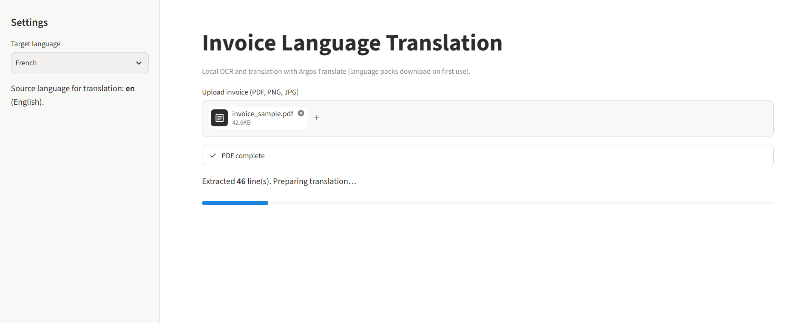
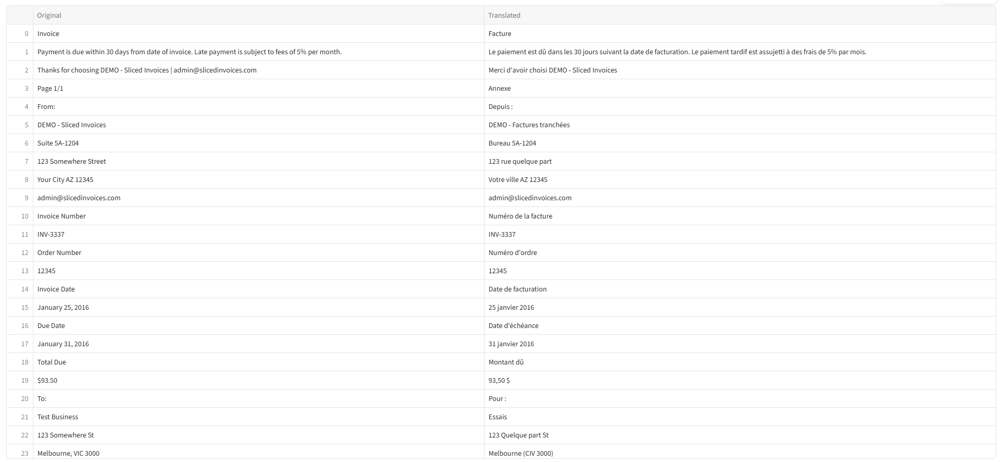
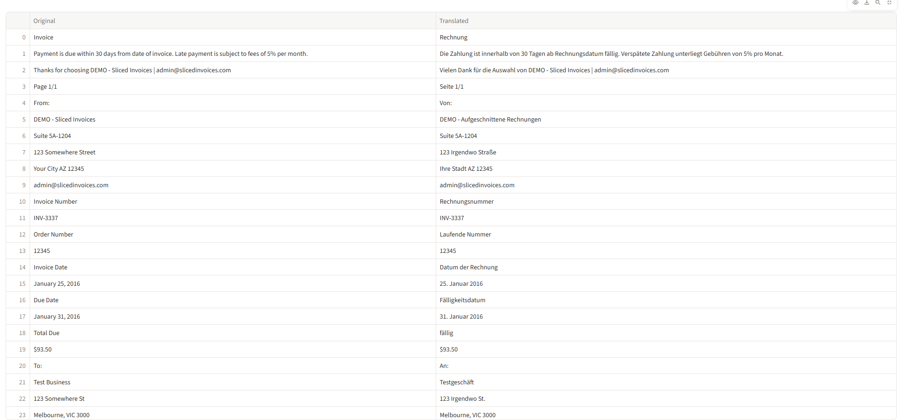

# Invoice Language Translation

Translate invoice content into a single target language for review and downstream processing. Upload a PDF or image; the app reads embedded PDF text or runs OCR on scans, then translates line by line using Argos Translate on your machine.

## Features

- PDF and image upload (PNG, JPG, JPEG)
- PDF text layer when present; EasyOCR for image-only pages or photos
- Offline translation via Argos language packs (after first download)
- Side-by-side original and translated lines in a table
- CSV export of results

## How It Works

1. Choose a target language in the sidebar (source is English for translation).
2. Upload an invoice file.
3. Text is extracted per page (digital text or OCR).
4. Numeric-only and very short lines are left unchanged; other lines are translated.
5. Review the table and download CSV if needed.

## Prerequisites

- Python 3.10+
- Internet only for the first download of each Argos language pair and EasyOCR weights

## How to Run

From the project folder:

```powershell
cd WNS_Projects\Invoice_Language_Translation
python -m venv .venv
.\.venv\Scripts\Activate.ps1
pip install -r requirements.txt
streamlit run app.py
```

The app opens in the browser (default `http://localhost:8501`).

## User Interface



## Sample Output





## Notes

- Argos packs are cached after install; later runs do not need the network for translation.
- OCR is configured for English (`en`). Non-English invoices need a readable scan and matching source text for best results.
- Very large PDFs take longer because OCR runs per page when no text layer exists.

## Project Background

Organizations that handle cross-border vendors often receive invoices in several languages. Finance teams need a consistent language for approval and posting. This module demonstrates document ingestion (PDF/image), computer vision (OCR), and NLP-style translation in a small Streamlit app suitable for local demos and training exercises.
