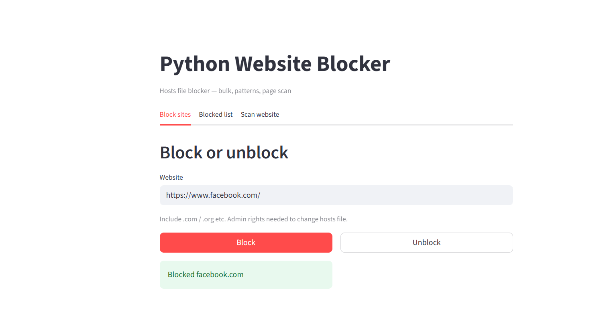
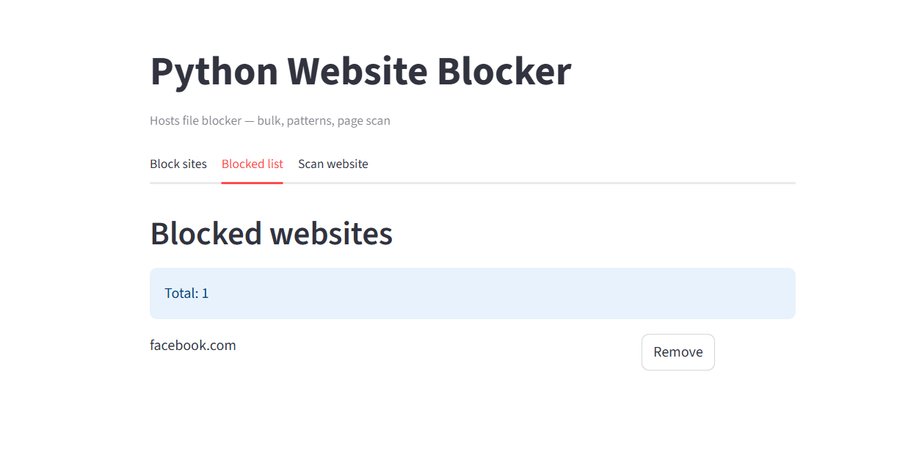
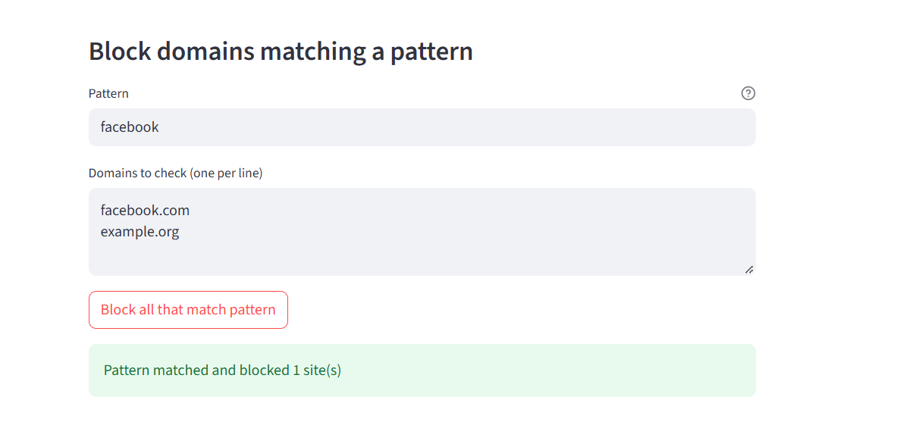
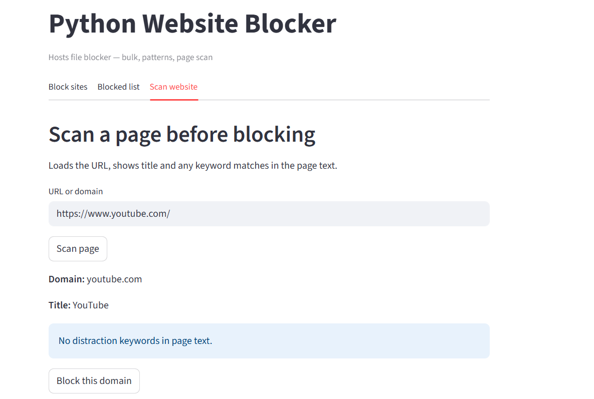
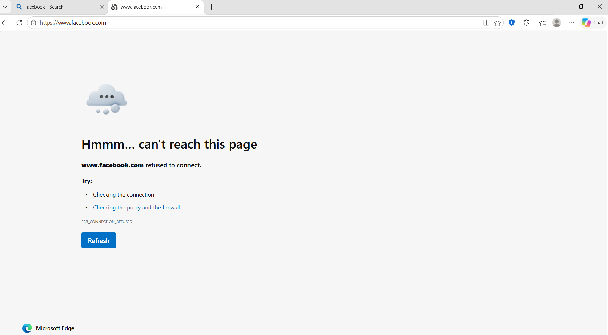

# Python Website Blocker (Yugandhar — WNS Skense)

## Project background

This is a Streamlit app that blocks websites by editing the system **hosts** file. Each blocked domain is mapped to `127.0.0.1`, so browsers on this PC cannot reach the real server.

**Assignment scope (how this repo maps to it):**

| Requirement | Implementation |
|-------------|----------------|
| User input | Block / Unblock field, bulk list, pattern + candidate domains, scan URL |
| Blocking websites | `block_website()` / `unblock_website()` on hosts file |
| Pattern recognition | `DOMAIN_RE`, `domain_matches_pattern()`, keyword check on scraped text |
| Web scraping | **Scan website** tab — `requests` + BeautifulSoup (`scrape_page()`) |

All logic is in `app.py`.

## How it works (short)

1. **clean_url()** — strips `https://`, `www.`, paths; validates domain with regex.
2. **Block** — appends `127.0.0.1 domain` and `127.0.0.1 www.domain` to the hosts file.
3. **Pattern block** — pattern is a rule (`facebook`, `*.org`), not a full URL; only matching lines in the candidate list are blocked.
4. **Scan** — downloads HTML, reads title and body text, checks fixed keywords (`DISTRACTION_KEYWORDS`).

Blocking needs **Administrator** on Windows. Scan only uses HTTP and does not need admin.

## How to run

1. Python 3.10+ installed.
2. **PowerShell → Run as administrator** (required for block/unblock).
3. Commands:

```powershell
cd W:\Yugandhar_WNS_Projects\Python_Website_Blocker
python -m venv .venv
.\.venv\Scripts\activate
pip install -r requirements.txt
streamlit run app.py
```

4. Open `http://localhost:8501` in the browser.

If you start without admin, a red banner appears at the top and block actions fail until you restart Streamlit from an admin terminal.

## Application screenshots

Screenshots are in `assets/`. Together they show: block from the app → list → pattern rule → scrape → browser cannot open the blocked site (system-wide).

### 01 — Block success



User enters a domain on **Block sites** and gets a success message after **Block** (hosts file updated).

### 02 — Blocked list



**Blocked list** tab reads domains from the hosts file and shows the total count.

### 03 — Pattern block



**Pattern** + candidate domains: only sites matching the rule are blocked (pattern recognition scope).

### 04 — Scan example



**Scan website** tab: HTTP fetch + HTML parse (web scraping); shows domain, title, and keyword hits if any.

### 05 — Post-run output (browser)



After blocking `facebook.com`, Edge cannot open `https://www.facebook.com` (“can’t reach this page” / connection refused). This confirms blocking works outside Streamlit, not only in the app UI.

## Manual test guide (no pytest)

- [ ] Streamlit started from **Administrator** PowerShell.

### Test 1 — Block

**Block sites** → `example.com` → **Block** → green success; hosts file has two lines for `example.com`.

### Test 2 — Invalid input

`geeksforgeeks` → **Block** → error (full domain required).

### Test 3 — Duplicate block

Block `example.com` again → **Already blocked!**

### Test 4 — Blocked list

**Blocked list** shows `example.com`.

### Test 5 — Unblock

**Remove** or **Unblock** with `example.com` → site removed from list and hosts file.

### Test 6 — Bulk block

Two domains, one per line → **Block all** → count message.

### Test 7 — Pattern recognition

- Pattern: `example`
- Candidates: `example.com`, `google.com`
- **Block all that match pattern** → only `example.com` blocked.

### Test 8 — Web scraping

**Scan website** → `https://example.com` → **Scan page** → title **Example Domain** (keywords may be none).

### Test 9 — Scan then block

**Block this domain** after scan → appears on **Blocked list**.

### Test 10 — No admin (optional)

Normal PowerShell → **Block** → permission / banner error.

## Troubleshooting

| Issue | Fix |
|-------|-----|
| Permission / admin banner | Close app; run `streamlit run app.py` as Administrator |
| Site still opens | Private window; verify hosts file |
| Scan fails on some sites | Site blocks bots; use `https://example.com` |
| Pattern does nothing | Pattern must be `facebook` or `*.org`, not `https://...` |

## Project files

- `app.py` — UI and hosts/scrape logic  
- `requirements.txt` — streamlit, requests, beautifulsoup4  
- `README.md` — setup, tests, screenshots  
- `assets/` — your screenshots (you create this folder)

## Submission checklist

- [ ] GitHub repo with README  
- [x] Screenshots in `assets/` (`01`–`05`) with commentary above  
- [ ] Brief report or README notes for manual tests 1–9  
