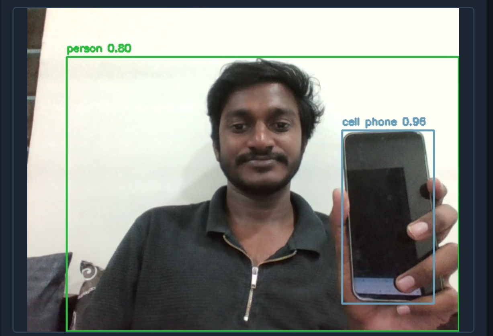

# Real-Time Object Detection

Flask web app that runs YOLOv8 on a live webcam feed and streams annotated video to the browser. Bounding boxes and class labels appear on each frame for surveillance-style demos, workspace monitoring, or training exercises in computer vision.

## Features

- Live webcam capture with OpenCV
- YOLOv8 nano (`yolov8n.pt`) — weights download on first run
- MJPEG browser stream with labeled detections
- Confidence threshold (default 0.5)
- JSON status route at `/status`

## Project Background

Object detection is a core computer vision skill for delivery teams working on analytics, IoT, and automation. This project shows how to wrap a YOLO model in a small Flask service, process frames in a loop, and expose results through a web UI and a simple REST endpoint — similar patterns used in larger monitoring or edge deployments.

## Prerequisites

- Python 3.10+
- Webcam (built-in or USB)
- Internet on first run to download YOLOv8 weights (unless `yolov8n.pt` is already cached)

## How to Run

From the project folder:

```powershell
cd WNS_Projects\Real_Time_Object_Detection
python -m venv .venv
.\.venv\Scripts\Activate.ps1
pip install -r requirements.txt
python app.py
```

Open `http://127.0.0.1:5001` in a browser.

Optional status check:

```powershell
curl http://127.0.0.1:5001/status
```

## How It Works

1. OpenCV reads frames from the default camera (`CAMERA_INDEX` in `app.py`).
2. Frames are resized for streaming, then passed through YOLOv8.
3. Detections above the confidence threshold get boxes and labels drawn on the frame.
4. Flask serves HTML at `/` and an MJPEG stream at `/video_feed`.

## Sample Output



## Configuration

| Setting | Location | Default |
|--------|----------|---------|
| Confidence | `CONFIDENCE` in `app.py` | `0.5` |
| Camera | `CAMERA_INDEX` in `app.py` | `0` |
| Port | `PORT` in `app.py` | `5001` |

## Notes

- Model weights are not committed to git; Ultralytics downloads `yolov8n.pt` when needed.
- Close other apps using the webcam if the stream is blank.
- GPU speeds up inference if PyTorch with CUDA is installed; CPU still works for demos.
- Processing stays on your machine; no cloud API calls after weights are cached.
