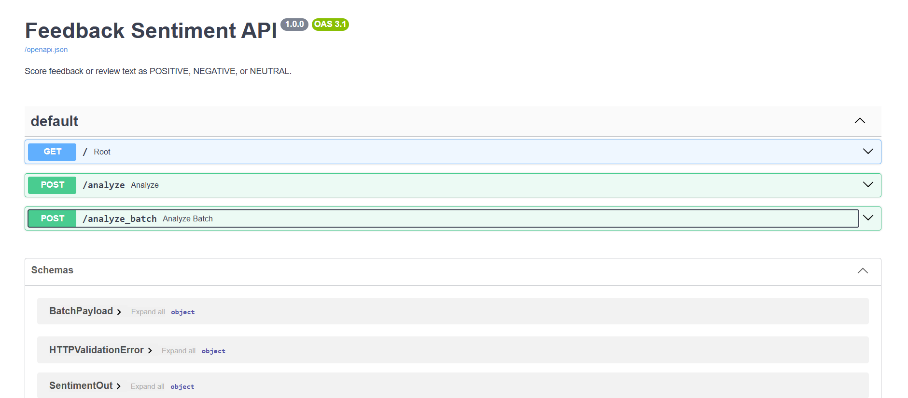
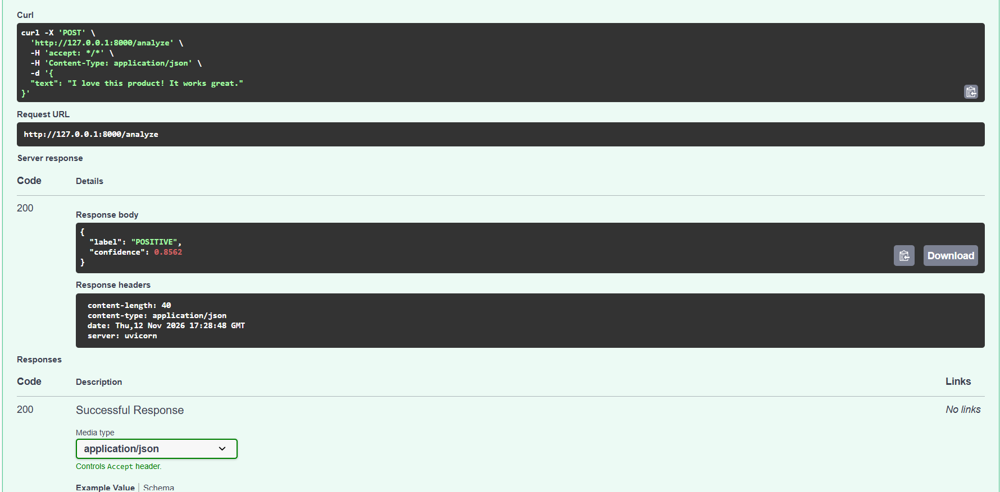
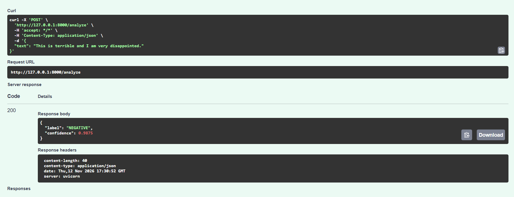
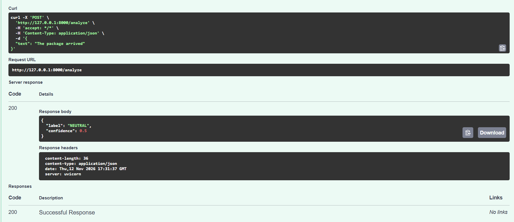
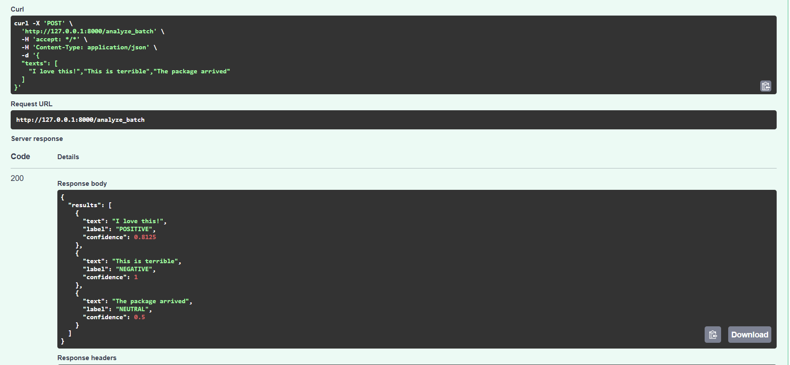

# Sentiment Analysis API

FastAPI service that scores short text as positive, negative, or neutral. Use it on customer feedback or review snippets.

## Features

- Single-text scoring at `POST /analyze`
- Batch scoring at `POST /analyze_batch`
- Confidence in the 0–1 range
- Swagger UI at `/docs`
- TextBlob polarity (no large model download)

## Project Background

Delivery teams often need a small REST service that can tag comments as positive, negative, or neutral before they go into reporting or support queues. This project wraps TextBlob polarity scoring in FastAPI so you can send JSON and get a label plus a confidence score.

## Prerequisites

- Python 3.10+

## How to Run

From the project folder:

```powershell
cd WNS_Projects\Sentiment_Analysis_API
python -m venv .venv
.\.venv\Scripts\Activate.ps1
pip install -r requirements.txt
uvicorn app:app --reload
```

Open `http://127.0.0.1:8000/docs` in a browser.

Optional health check:

```powershell
curl.exe http://127.0.0.1:8000/
```

## How It Works

1. Client sends text as JSON.
2. TextBlob computes polarity from -1 to 1.
3. Polarity maps to POSITIVE (`> 0`), NEGATIVE (`< 0`), or NEUTRAL (`0`).
4. Confidence is derived from polarity strength and rounded to 4 decimal places.

## User Interface



## Sample Output









## API Endpoints

### GET `/`

```json
{"status": "ok", "message": "Open /docs to try the API"}
```

### POST `/analyze`

```json
Request:
{
  "text": "I love this product! It works great."
}

Response:
{
  "label": "POSITIVE",
  "confidence": 0.85
}
```

### POST `/analyze_batch`

```json
Request:
{
  "texts": [
    "I love this!",
    "This is terrible",
    "The package arrived"
  ]
}

Response:
{
  "results": [
    {"text": "I love this!", "label": "POSITIVE", "confidence": 0.85},
    {"text": "This is terrible", "label": "NEGATIVE", "confidence": 0.75},
    {"text": "The package arrived", "label": "NEUTRAL", "confidence": 0.5}
  ]
}
```

Empty `text` on `/analyze` returns HTTP 400.

## Notes

- Scoring runs on your machine. No cloud API calls.
- No model weights to download.
- Confidence is rounded to 4 decimal places.
- Batch scoring uses the same polarity rules as single-text scoring.
