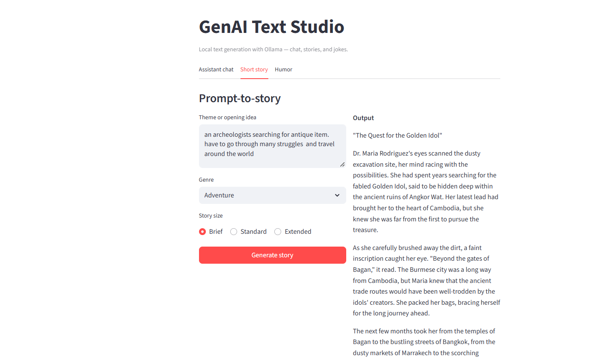

# Text Generator

Streamlit app for local GenAI text generation: multi-turn chat, themed short stories, and topic-based jokes. Inference runs on your machine through [Ollama](https://ollama.com).

## Features

- **Assistant chat** — streaming replies with session history and a clear-history control
- **Short story** — genre, size, and theme controls with structured prompts
- **Humor** — one-liners, puns, dad jokes, and knock-knock jokes from a subject line
- **Configurable models** — `mistral`, `llama3.2`, or `llama3` with adjustable randomness

## Project Background

Skense delivery training covers NLP and GenAI module development. This project shows how to wrap a local LLM in a small Python UI: LangChain prompt templates, Ollama as the backend, and three focused generation flows in one app. It is suitable for demos, coursework submission, and as a starting point for richer RAG or API-backed services.

## Prerequisites

- Python 3.10 or later
- [Ollama](https://ollama.com) installed and running
- At least one pulled model, for example:

```powershell
ollama pull llama3.2
```

Optional additional models:

```powershell
ollama pull mistral
ollama pull llama3
```

## How to Run

From the repository root:

```powershell
cd WNS_Projects\Text_Generator
python -m venv .venv
.\.venv\Scripts\Activate.ps1
pip install -r requirements.txt
streamlit run app.py
```

The app opens in your browser (default `http://localhost:8501`).

Confirm Ollama is reachable:

```powershell
ollama list
```

## How It Works

1. **Sidebar** — pick an Ollama model and temperature; optionally clear chat history.
2. **Chat** — user messages are sent directly to the model; responses stream into the UI.
3. **Story** — a system prompt sets genre and target length; the user theme drives the plot.
4. **Joke** — a system prompt fixes the joke format; the subject line sets the topic.

Core logic lives in `llm_client.py` (`ChatOllama`, `ChatPromptTemplate`, `StrOutputParser`). The UI is in `app.py`.

## Sample Output





## Manual Test Cases

Run these after `streamlit run app.py` with Ollama running and `llama3.2` (or another sidebar model) available.

| ID | Area | Steps | Expected result |
|----|------|--------|-----------------|
| T1 | Startup | Start the app | Browser shows three tabs and sidebar model controls |
| T2 | Chat | Open **Assistant chat**, send `What is JSON?` | User bubble appears; assistant streams a coherent answer |
| T3 | Chat history | Send a second message in chat | Both turns remain visible in order |
| T4 | Clear chat | Click **Clear chat history**, send a new message | Only the new exchange is shown |
| T5 | Chat error | Stop Ollama, send a chat message | Error explains Ollama is unavailable (no crash) |
| T6 | Story happy path | **Short story**: theme `A robot learns music`, genre **Science fiction**, size **Brief**, click **Generate story** | Story text with title appears in the output column |
| T7 | Story validation | Click **Generate story** with an empty theme | Warning to enter a theme; no API call |
| T8 | Story length | Same theme, run **Brief** then **Extended** | Extended output is noticeably longer than Brief |
| T9 | Joke happy path | **Humor**: subject `programming`, format **Pun**, click **Make me laugh** | Single joke shown in the output panel |
| T10 | Joke validation | Click **Make me laugh** with empty subject | Warning to enter a subject |
| T11 | Joke formats | Subject `ocean`, try **One-liner** and **Knock-knock** | Different joke structures each time |
| T12 | Model switch | Sidebar: switch model, repeat T2 | Response still generated (model must be pulled in Ollama) |
| T13 | Temperature | Set randomness to `0.1`, generate two jokes on `cats` | Two similar jokes; at `1.0`, more variation |

## Dependencies

| Package | Version | Role |
|---------|---------|------|
| streamlit | 1.46.1 | Web UI |
| langchain-ollama | 0.3.10 | Ollama chat model wrapper |
| langchain-core | 0.3.86 | Prompts, chains, output parsing |

## Notes

- All generation is local; no cloud API keys are required.
- First reply can be slow while the model loads into memory.
- GPU-backed Ollama reduces latency when a supported GPU is available.

## Project Layout

```
Text_Generator/
├── app.py              # Streamlit UI
├── llm_client.py         # Ollama + LangChain helpers
├── requirements.txt
├── screenshots/          # UI captures for README
└── README.md
```